# Manual de uso — Elsa SYS

Elsa SYS es el sistema de la farmacia en el navegador: ventas, ingresos de mercadería, inventario, caja y reportes. El menú de arriba es el mismo en todas las pantallas.

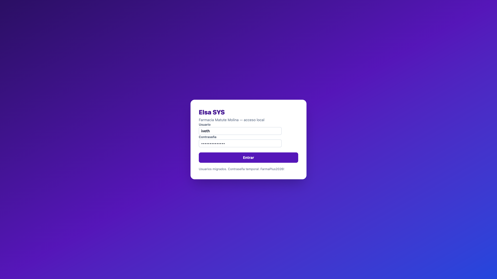

## Cómo entrar

1. Abra Elsa SYS en el navegador (en esta red suele ser `http://192.168.123.37:5173/` o `http://localhost:5173/`).
2. En **Usuario** escriba el usuario que ya tenía en el sistema anterior (por ejemplo `iveth`).
3. Use la contraseña temporal que aparece al pie de la pantalla de acceso.
4. Pulse **Entrar**.

**Salir** cierra la sesión. **Dashboard**, **Contado**, **Crédito**, **Ingresos**, **Caja**, **Productos**, **Clientes**, **Reportes** y **Configuración** son los módulos.

---

## Conceptos que hay que tener claros

Estos nombres se repiten en ingresos, ventas y reportes. No son lo mismo.

| Concepto | Qué es |
| --- | --- |
| **Existencia** | Todo lo físico del producto: despacho + bodega. Es lo que se puede vender. |
| **Despacho** | Lo que está listo para vender al precio viejo (**P1**). Es lo primero que se descuenta al facturar. |
| **Bodega** | Lo que entró con un **precio nuevo** (**P2**). No se mezcla con el despacho hasta que el despacho se acaba. |
| **P1 / P. venta 1** | Precio de venta anterior. El despacho se vende a este precio. |
| **P2 / P. venta 2** | Precio de venta nuevo. A veces es igual a P1. Si cambia, lo nuevo va a bodega. |
| **Cajas a ingresar** | Cuántas cajas o frascos trae la factura del proveedor. |
| **Unid/caja** | Cuántas unidades trae cada caja (Cystone: 100). |
| **Unidades a ingresar** | Cajas × unid/caja. Se calcula solo. |
| **Fecha factura** | Fecha del documento del proveedor. |
| **Vencimiento** | Fecha del lote. Un ingreso nuevo **no borra** el lote anterior. |
| **Lote** | Grupo de unidades con su propia fecha de vencimiento. Se vence primero lo más viejo (FEFO). |
| **Contado** | Venta cobrada al momento (efectivo y/o tarjeta). |
| **Crédito** | Venta que queda a deber, con adelanto opcional. |
| **Importe** | Precio × cantidad. |
| **Tipo de cambio** | Solo para mostrar el total en dólares. El cobro es en córdobas. |
| **Stock bajo** | Producto en o por debajo de su mínimo. |

### Despacho, bodega y precios (regla de oro)

Ejemplo: había **11** en despacho. Llegan **10** más.

- Si **P2 es igual a P1**, los 10 se suman al despacho: quedan **21** en despacho.
- Si **P2 cambia**, los 10 van a **bodega** y el despacho se queda en **11**.

Al vender:

- Primero se vende el **despacho a P1**.
- Si hace falta más, se vende de **bodega a P2**.
- Si despacho y bodega tienen **la misma cantidad**, esa venta usa el **precio más alto**.
- El precio mayor siempre lleva **borde ámbar**, para verlo de un vistazo.

En el Windows viejo solo se podía vender lo de despacho. Aquí se puede vender toda la **existencia**, y el despacho se sigue viendo.

---

## Dashboard

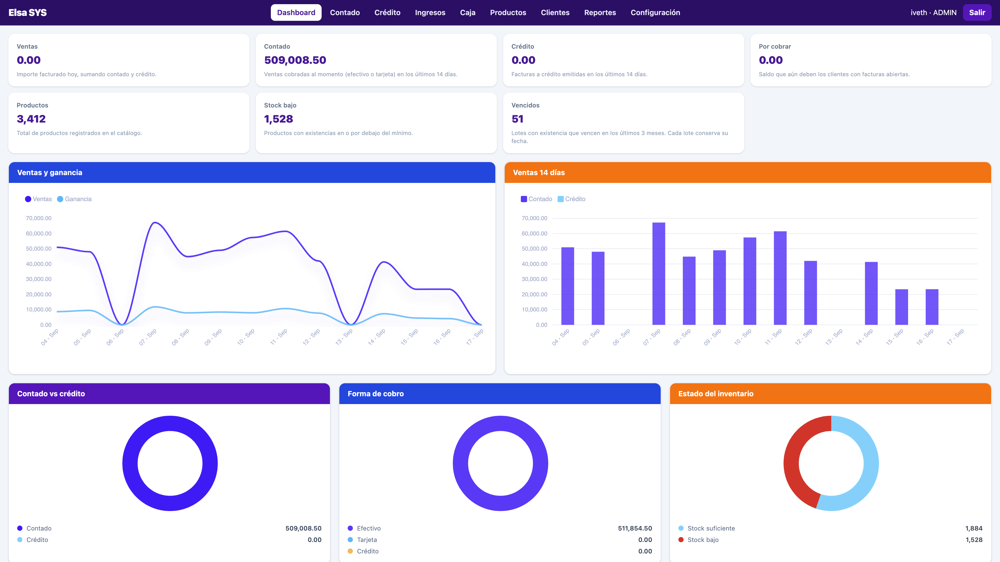

Es el tablero del día. Cada tarjeta tiene una frase pequeña que explica el número.

- **Ventas**: lo facturado hoy (contado + crédito).
- **Contado / Crédito**: cómo se ha cobrado en los últimos 14 días.
- **Por cobrar**: lo que aún deben los clientes.
- **Productos**: cuántos hay en el catálogo.
- **Stock bajo**: cuántos están en o bajo el mínimo.
- **Vencidos**: lotes con existencia que vencen en los últimos 3 meses. Va al final del tablero.

Los gráficos muestran ventas y ganancia, mezcla de cobro y salud del inventario. Las fechas se leen como `05 - Sep`.

---

## Contado (venta del día)

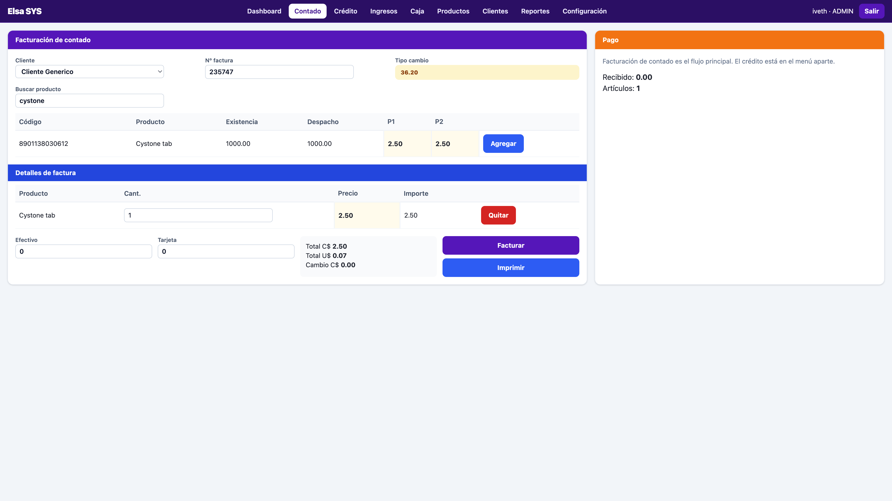

Es el flujo principal de caja.

1. Deje **Cliente Generico** si no es a nombre de alguien, o elija un cliente.
2. En **Buscar producto** escriba código, nombre o marca.
3. En la tabla verá **Existencia**, **Despacho**, **P1** y **P2**. El mayor va con borde.
4. Pulse **Agregar**. La cantidad empieza en 1.
5. Si vende un frasco por unidades (Diamel, 30 cápsulas), cambie la cantidad a 30 a mano. No hay botón de Caja/Unidad: siempre es **Agregar**.
6. Si la venta cruza despacho y bodega, el carrito puede partirse en dos líneas: una *(Despacho)* y otra *(Bodega)*, cada una con su precio.
7. Indique **Efectivo** y/o **Tarjeta**. El total debe cubrirse.
8. **Facturar** guarda e imprime el ticket de 80 mm. **Imprimir** reimprime sin volver a cobrar.

No se puede facturar sin pago. La cantidad no puede quedar vacía.

---

## Crédito

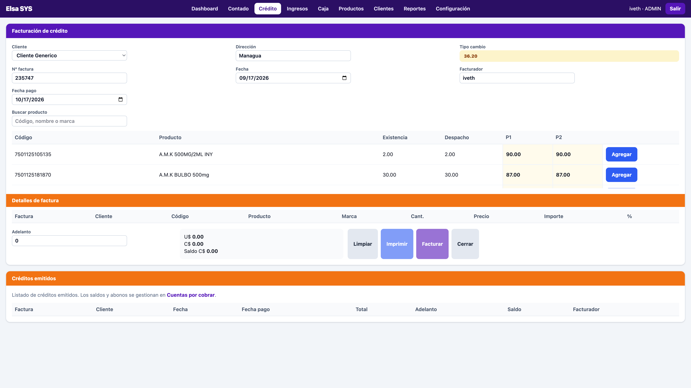

Igual que contado para buscar y agregar productos (existencia, despacho, P1 y P2).

Diferencias:

- Elija el **cliente** (nombre y dirección).
- Ponga **Fecha pago** (vence).
- **Adelanto** es opcional. El **saldo** es total menos adelanto.
- Abajo queda el listado de créditos emitidos. Los abonos se hacen en **Reportes → Cuentas por cobrar**.

---

## Ingresos (factura del proveedor)

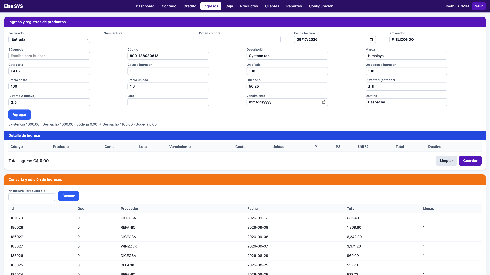

Aquí entra mercadería nueva o se actualiza un producto que ya existe.

### Encabezado

- **Facturado**: normalmente *Entrada*.
- **Num factura** y **Orden compra** del proveedor.
- **Fecha factura**: fecha del documento, no la de hoy si la factura es de otro día.
- **Proveedor**: obligatorio para guardar.

### Línea del producto

1. En **Búsqueda** escriba el nombre o código y pulse la fila (Cystone, etc.).
2. **Cajas a ingresar** × **Unid/caja** = **Unidades a ingresar**. Ejemplo: 10 cajas × 100 = 1000.
3. **Precio costo** es el de la caja. **Precio unidad** se calcula solo.
4. **P. venta 1** es el precio que ya tenía (queda bloqueado si eligió un producto existente).
5. **P. venta 2** es el precio nuevo. Puede dejarlo igual.
6. **Destino** no se elige: si P2 cambia, el sistema pone **Bodega**; si no, **Despacho**.
7. Debajo verá el preview: Existencia / Despacho / Bodega y cómo quedan después.
8. **Lote** y **Vencimiento**: si ya había otro vencimiento, el lote viejo se conserva y se vence primero.
9. **Marca** y **Categoría** se escriben o se eligen de la lista. No hay que ir a otra ventana a crearlas.
10. **Agregar** manda la línea al detalle. **Guardar** registra el ingreso.

Para un producto nuevo, llene código, descripción, marca, categoría y precios; al guardar se crea el producto.

---

## Caja

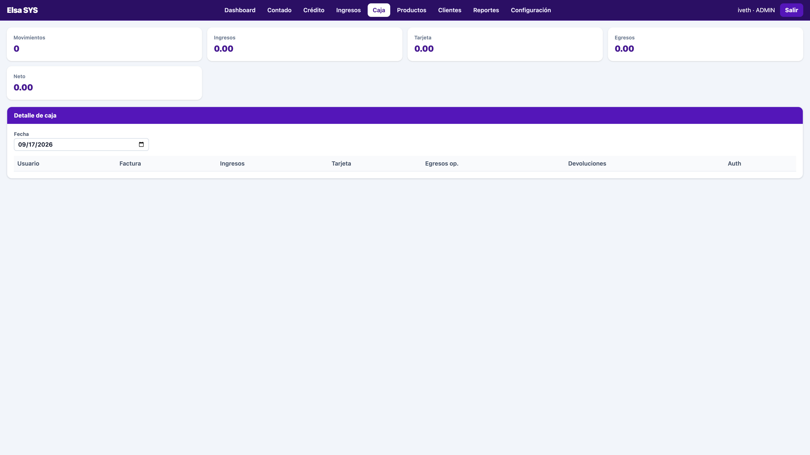

Movimientos de efectivo y tarjeta del día: ingresos, tarjeta, egresos, devoluciones y neto. Cambie la **Fecha** para ver otro día.

Cada venta de contado deja una línea. Una anulación de factura también aparece como devolución.

---

## Productos

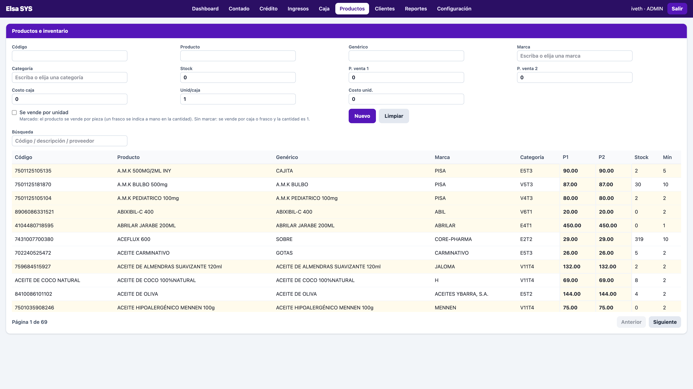

Catálogo: código, nombre, genérico, marca, categoría, stock, mínimo, unid/caja, P1 y P2.

- Pulse una fila para editarla.
- **Nuevo** limpia el formulario.
- Marca y categoría se escriben o se eligen.
- El precio más alto lleva borde.
- La tabla tiene páginas para no cargar todo de una vez.
- **Se vende por unidad** es una marca de catálogo (Diamel sí). En la venta el botón sigue siendo solo **Agregar**; si es por unidad, usted escribe 30 en la cantidad cuando vende el frasco.

---

## Clientes

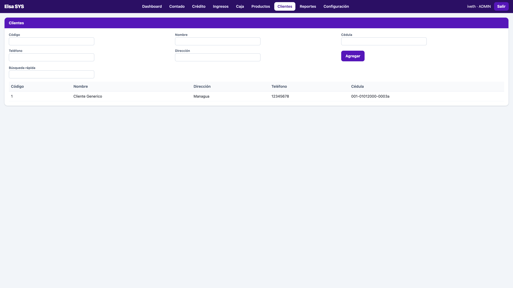

Alta y edición: código, nombre, cédula, teléfono y dirección. **Cliente Generico** es el de las ventas de mostrador. La búsqueda rápida filtra la lista.

---

## Reportes

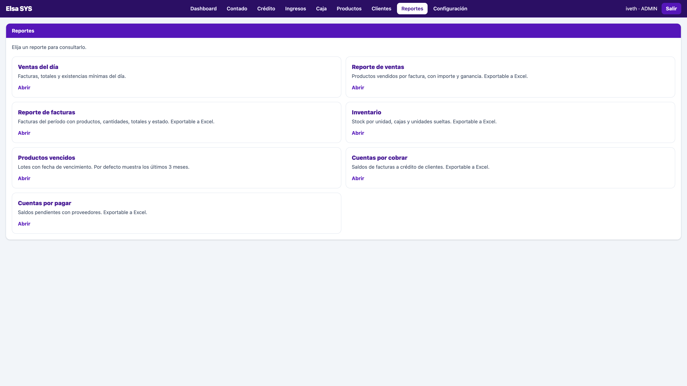

Todos los reportes viven aquí. Varios exportan a **Excel**. Las tablas tienen **páginas** y los totales usan **separadores de miles**.

### Ventas del día

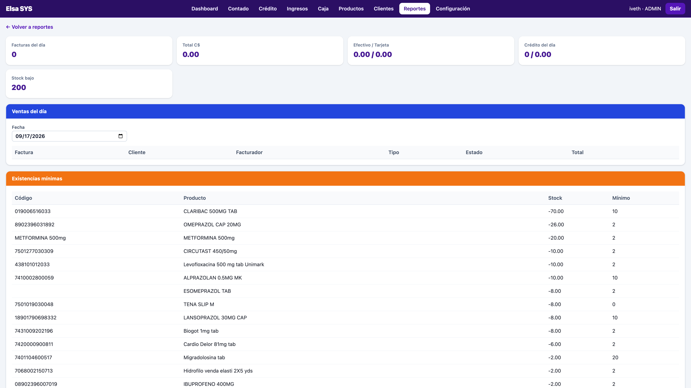

Facturas de la fecha, total, efectivo/tarjeta, crédito del día y lista de **existencias mínimas**. Desde aquí se puede **anular** una factura (devuelve stock). Cambie la fecha para otro día.

### Reporte de ventas

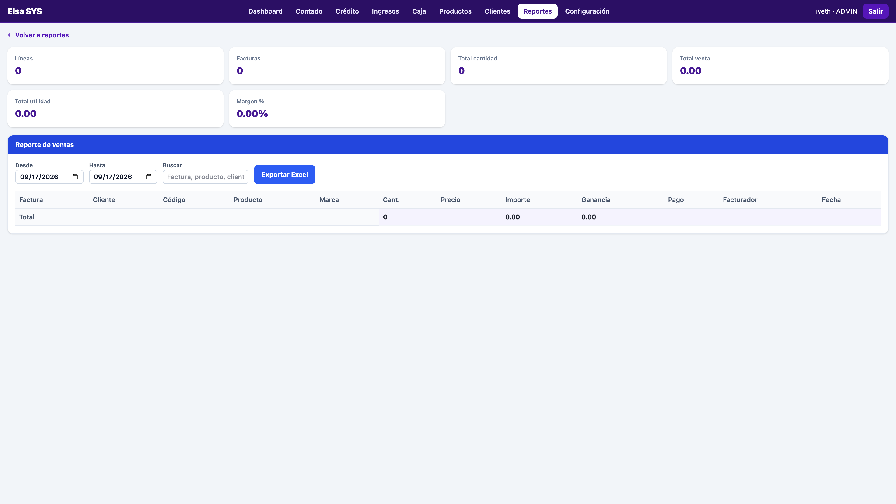

Líneas vendidas en un rango: producto, cantidad, importe y ganancia. Filtro por factura, producto o cliente. Exportable a Excel.

### Reporte de facturas

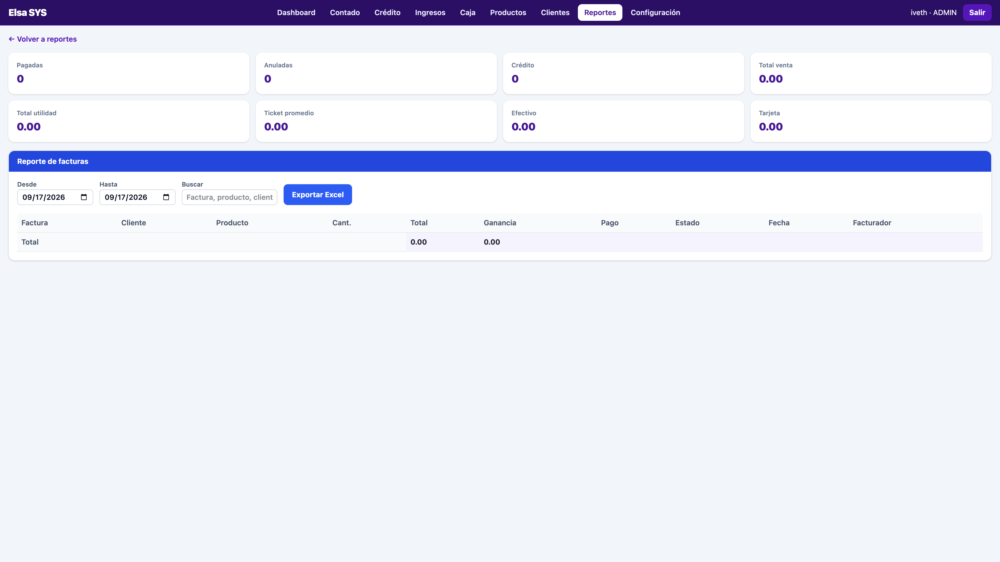

Cada factura del período, con **qué producto se vendió y la cantidad**, totales y estado (pagada, crédito, anulada). Exportable a Excel.

### Inventario

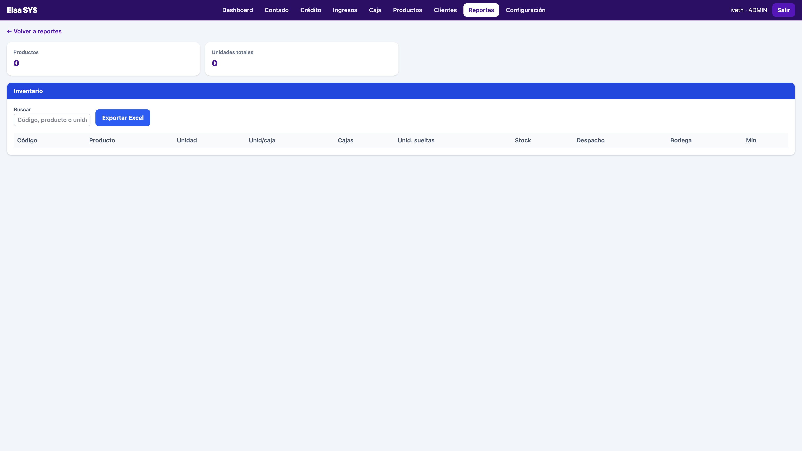

Stock por producto: unidades, cajas, sueltas, **stock**, **despacho**, **bodega** y mínimo. Es el “tanto por tanto” (12 en caja + 3 sueltas, etc.). Exportable a Excel.

### Productos vencidos

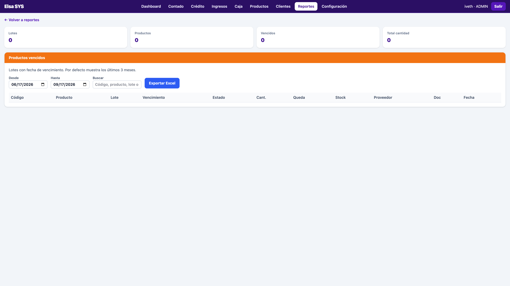

Lotes con fecha de vencimiento. Por defecto mira **3 meses atrás hasta hoy**. Cada lote muestra cuánto **queda**. Un lote nuevo no tapa al viejo.

### Cuentas por cobrar

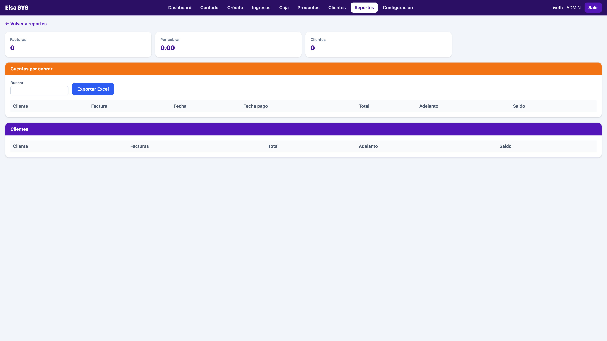

Saldos de facturas a crédito. Aquí se **registra un abono**. Exportable a Excel.

### Cuentas por pagar

Saldos con proveedores (facturas de compra pendientes). Exportable a Excel.

---

## Configuración

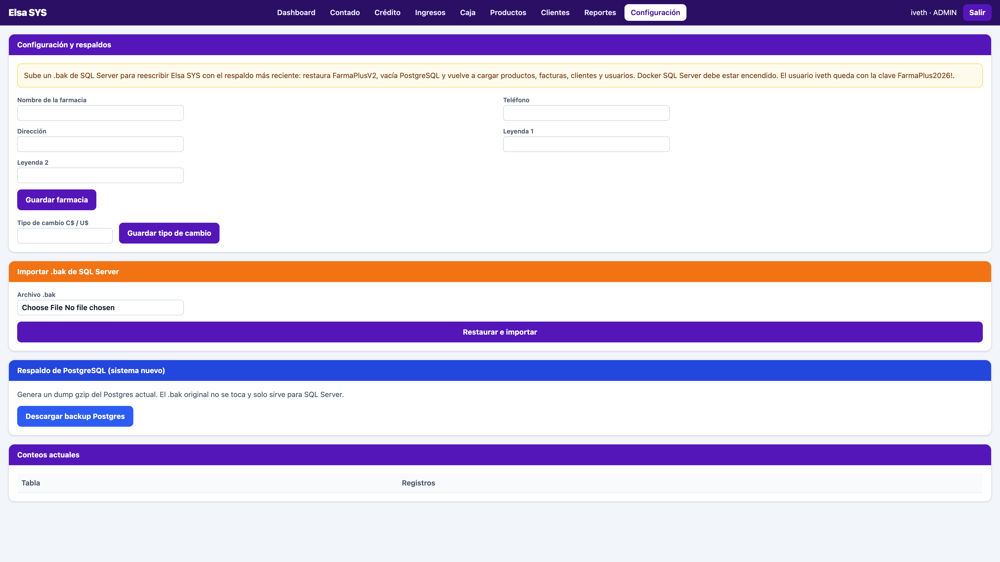

- **Nombre de la farmacia**, teléfono, dirección y leyendas del ticket.
- **Tipo de cambio** C$ / U$ (solo para mostrar dólares).
- **Importar .bak**: sube un respaldo de SQL Server del sistema viejo, restaura FarmaPlusV2 y **reescribe** productos, facturas, clientes y usuarios de Elsa SYS. Docker de SQL Server debe estar encendido. Pide confirmación porque borra lo actual.
- **Descargar backup Postgres**: respaldo del sistema nuevo. El `.bak` original de Windows no se toca.

---

## Ticket de venta

Al facturar se abre el comprobante de **80 mm**: farmacia, número, cliente, líneas, total C$, recibido y cambio (o adelanto y saldo en crédito). En la impresora térmica use **Imprimir**.

---

## Errores frecuentes

| Qué pasa | Qué hacer |
| --- | --- |
| “Stock insuficiente” | La cantidad pasa la **existencia** (despacho + bodega). Baje la cantidad. |
| “Indique efectivo o tarjeta” | En contado hay que poner un pago. |
| “El pago no cubre el total” | Efectivo + tarjeta debe alcanzar el total. |
| “Indique proveedor y al menos una línea” | En ingresos falta proveedor o no pulsó **Agregar** antes de **Guardar**. |
| La búsqueda no lista nada | Escriba al menos una letra y espere un segundo. |
| P1 y P2 se ven iguales | Todavía no hubo un ingreso con precio nuevo. El borde ámbar marca el mayor (los dos, si empatan). |
